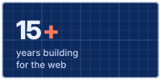
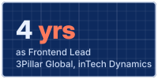
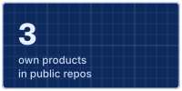
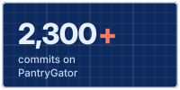
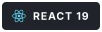
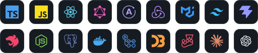

<h1 align="center">Hi, I'm George Vrancianu</h1>

<p align="center"><b>AI-Driven Product Developer · Senior Frontend Engineer</b></p>

<p align="center">
  
</p>

<p align="center">
  <a href="https://george.vrancianu.eu"></a>
  <a href="https://www.linkedin.com/in/george-vrancianu-34a3a918/"></a>
  <a href="https://george.vrancianu.eu/projects/pantrygator/"></a>
  <a href="https://george.vrancianu.eu/contact/"></a>
</p>

<p align="center">
  
</p>


## About me

- **Now:** building [PantryGator](https://george.vrancianu.eu/projects/pantrygator/), a mobile-first AI pantry and shared shopping list for households, on React 19, TypeScript, NestJS and PostgreSQL.
- **Before:** 15+ years of frontend work, mostly remote and mostly on enterprise products under NDA: cybersecurity at Orion, renewable energy at Remobi, delivery at Clever Software Solutions, and LexisNexis products at 3Pillar Global, where I was Frontend Lead.
- **AI in the product:** OpenAI vision workflows for receipts, product labels, produce and dishes, voice notes that become pantry and shopping actions, and structured output the user reviews before anything is saved.
- **AI in the workflow:** Claude and OpenAI Codex every day for implementation, debugging and code exploration. Agent-assisted pull requests go through CI and a human review gate.
- **Looking for:** senior or lead frontend and AI product roles, remote or hybrid from Timișoara, Romania.
- **Languages:** English, Romanian, French (beginner).

```ts
const george: ProductDeveloper = {
  role: "AI-Driven Product Developer · Senior Frontend Engineer",
  experience: "15+ years",
  frontend: ["React", "TypeScript", "Material UI", "Tailwind CSS", "React Table"],
  data: ["GraphQL", "Apollo Client", "Redux", "React Query"],
  product: ["NestJS", "PostgreSQL", "OpenAI API"],
  ai: ["Claude", "OpenAI Codex", "agent PRs with human review"],
  openTo: "Senior or lead frontend and AI product roles, remote or hybrid",
};
```


## At a glance

<p align="center">
  
  
  
  
</p>


## What I do best

<table>
  <tr>
    <td width="50%" valign="top">
      <b>Frontend architecture</b><br>
      <sub><b>ORION · CYBERSECURITY CLIENT</b></sub><br>
      Reusable components and extensions for a large-scale enterprise application, and shared infrastructure used across teams: infinite-scroll loaders, extensible data tables.<br><br>
      
      
      
      
    </td>
    <td width="50%" valign="top">
      <b>Design systems</b><br>
      <sub><b>REMOBI · ENERGY CLIENT</b></sub><br>
      Designed the next-generation Material UI framework that replaced a Tailwind CSS and Headless UI implementation, for better reuse, maintainability and scale.<br><br>
      
      
      
    </td>
  </tr>
  <tr>
    <td width="50%" valign="top">
      <b>AI product engineering</b><br>
      <sub><b>PANTRYGATOR · PERSONAL PRODUCT</b></sub><br>
      OpenAI vision and voice workflows with structured output the user reviews, plus agent-assisted delivery through pull requests, CI and human review gates.<br><br>
      
      
      
    </td>
    <td width="50%" valign="top">
      <b>Technical leadership</b><br>
      <sub><b>3PILLAR GLOBAL · LEXISNEXIS</b></sub><br>
      Led the frontend rebuild of LexisNexis Entity Insight, introduced unit, snapshot and integration testing, set coding standards and onboarded developers.<br><br>
      
      
      
    </td>
  </tr>
</table>


## Selected work

<table>
  <tr>
    <td width="50%" valign="top">
      <b><a href="https://george.vrancianu.eu/projects/pantrygator/">PantryGator</a></b><br>
      <sub><b>PERSONAL PRODUCT · 2026</b></sub><br>
      Know what's in your kitchen, buy only what you need, and stop throwing food away. Scan a receipt, a label, loose produce or a dish. The whole household shares one pantry and one shopping list.<br><br>
      
      
      
      
      <br>
      <a href="https://george.vrancianu.eu/projects/pantrygator/">Case study</a> · <a href="https://github.com/george-vrancianu/PantryGator">Repository</a>
    </td>
    <td width="50%" valign="top">
      <b><a href="https://github.com/george-vrancianu/BreachBall">BreachBall</a></b><br>
      <sub><b>PLAYABLE PROTOTYPE</b></sub><br>
      Football meets siege. A two-player, turn-based pitch game for the browser: build walls and towers, then shoot pool-style to breach the other goal. Deterministic simulation, peer-to-peer online play. My playground for agent workflows: spec, ADRs and tests first.<br><br>
      
      
      
      
      <br>
      <a href="https://github.com/george-vrancianu/BreachBall">Repository</a>
    </td>
  </tr>
  <tr>
    <td width="50%" valign="top">
      <b><a href="https://github.com/george-vrancianu/aequate">Aequate</a></b><br>
      <sub><b>IN BUILD</b></sub><br>
      A shared blackboard for algebra tutoring. Handwriting read by a small model, every step checked by SymPy, with an optional local LLM to explain. Open source under AGPL-3.0.<br><br>
      
      
      
      <br>
      <a href="https://github.com/george-vrancianu/aequate">Repository</a>
    </td>
    <td width="50%" valign="top">
      <b><a href="https://george.vrancianu.eu/work-in-progress/">Grivei.ai</a></b><br>
      <sub><b>RESEARCH PHASE</b></sub><br>
      Public procurement as an explorable network. Contracts, firms and officials in one Postgres graph, every link tied to its source document.<br><br>
      
      
      <br>
      <a href="https://george.vrancianu.eu/work-in-progress/">Work in progress</a>
    </td>
  </tr>
</table>

Earlier open source at Cloudbase: [Coriolis web](https://github.com/george-vrancianu/coriolis-web), a React UI built from scratch for migrating VMs and networks across OpenStack, AWS, Azure and VMware, and [Aurora](https://github.com/george-vrancianu/aurora), an AngularJS admin UI for OpenStack.


## How I build with AI

<p>
  
  
  
  
  
  
</p>

<table>
  <tr>
    <td width="50%" valign="top"><b>Agent-assisted delivery</b><br>GitHub issues, agent-drafted pull requests and CI, with a human review gate before anything merges.</td>
    <td width="50%" valign="top"><b>Context first</b><br>My repos carry their conventions in writing: CLAUDE.md, a glossary and architecture decision records, so people and agents write code that fits.</td>
  </tr>
  <tr>
    <td width="50%" valign="top"><b>Human in the loop</b><br>AI agents draft the mechanical changes. A human approves every one.</td>
    <td width="50%" valign="top"><b>Reviewable AI output</b><br>Vision and voice results come back as structured output that the user checks before it is saved.</td>
  </tr>
</table>


## Tech stack

<p align="center">
  
</p>

<table>
  <tr>
    <td><b>Languages</b></td>
    <td>
      
      
      
      
    </td>
  </tr>
  <tr>
    <td><b>Frontend</b></td>
    <td>
      
      
      
      
      
      
      
    </td>
  </tr>
  <tr>
    <td><b>State and data</b></td>
    <td>
      
      
      
      
      
      
    </td>
  </tr>
  <tr>
    <td><b>Backend and delivery</b></td>
    <td>
      
      
      
      
      
    </td>
  </tr>
  <tr>
    <td><b>Visualization and realtime</b></td>
    <td>
      
      
      
      
    </td>
  </tr>
  <tr>
    <td><b>Testing</b></td>
    <td>
      
      
      
      
      
      
    </td>
  </tr>
  <tr>
    <td><b>Earlier stack</b></td>
    <td>
      
      
      
      
      
    </td>
  </tr>
</table>


## Experience

### Orion · Senior Frontend Engineer

`Mar 2024 – Oct 2026` `Remote` `Cybersecurity client (NDA)`

- Owned and designed complex reusable frontend components and extensions for a large-scale enterprise application.
- Built shared infrastructure components used across multiple teams, including infinite-scroll loaders and extensible data-table functionality.
- Implemented GraphQL integrations with Apollo Client: cache management, client-side state, loading and error handling.
- Applied Claude and OpenAI Codex across day-to-day engineering work.

### Remobi · Senior Frontend Engineer

`Aug 2021 – Mar 2024` `Remote` `Energy technology client (NDA)`

- Owned frontend delivery for diagnostics, monitoring and operational workflows for renewable power-plant systems, including data visualizations and advanced React Table interactions.
- Designed the next-generation Material UI framework that replaced a Tailwind CSS and Headless UI implementation.
- Coordinated frontend, backend and QA to reduce delivery bottlenecks.

### Clever Software Solutions · Senior Frontend Engineer

`Sep 2020 – Aug 2021` `Remote` `Delivery client (NDA)`

- Led frontend delivery orchestration that combined restaurant-managed and platform-managed delivery using location, order-queue and operational signals.
- Delivered restaurant-facing features in a large multi-team monorepo, with unit and end-to-end tests.

### 3Pillar Global · Frontend Lead

`Sep 2017 – Sep 2020` `Timișoara` `LexisNexis Entity Insight and Diligence`

- Led the frontend rebuild of LexisNexis Entity Insight, refactoring most of the codebase into a more scalable architecture with reusable component patterns.
- Introduced unit, snapshot and integration testing for React components.
- Built shared components across sister products, set coding standards and supported developer onboarding.

<details>
<summary><b>Earlier roles, 2007 – 2017</b></summary>
<br>
<table>
  <tr><td>2016 – 2017</td><td><b>Cloudbase</b> · Frontend Web Developer</td><td>Built the Coriolis React UI from scratch for migrating VMs and networks across OpenStack, AWS, Azure and VMware. Aurora, an AngularJS admin UI for OpenStack.</td></tr>
  <tr><td>2015 – 2016</td><td><b>Softvision</b> · Web Developer</td><td>SugarCRM modules with Backbone.js and PHP.</td></tr>
  <tr><td>2014 – 2015</td><td><b>inTech Dynamics</b> · Frontend Lead</td><td>Led responsive Drupal and WordPress delivery, trained developers, built workflow automation tools during a four-month US assignment.</td></tr>
  <tr><td>2013 – 2014</td><td><b>SimplySocial Inc</b> · Web Developer</td><td>Backbone.js social-media workflows for campaigns, collaboration, scheduling and approval.</td></tr>
  <tr><td>2011 – 2013</td><td><b>iSoftBet</b> · Web Developer</td><td>Casino game-management platform and a fully animated jQuery lobby.</td></tr>
  <tr><td>2007 – 2011</td><td><b>Freelance</b> · Web Developer</td><td>PHP, MySQL, JavaScript, HTML and CSS web projects.</td></tr>
</table>
</details>


<p align="center"><sub>More at <a href="https://george.vrancianu.eu">george.vrancianu.eu</a></sub></p>
